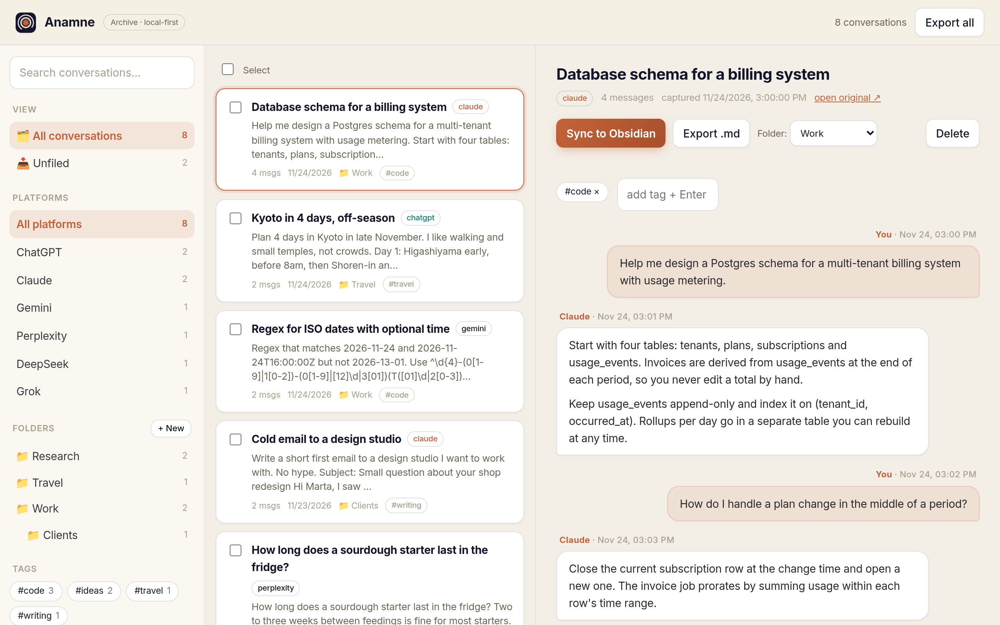
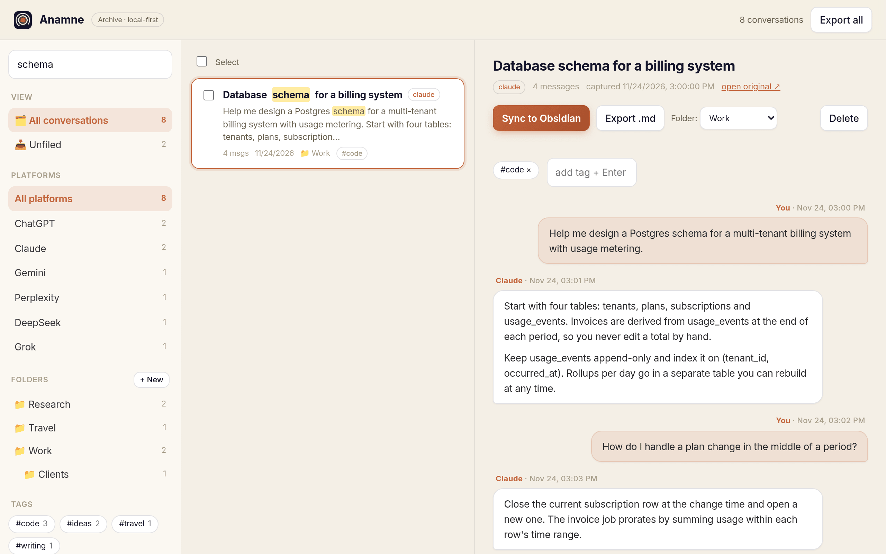
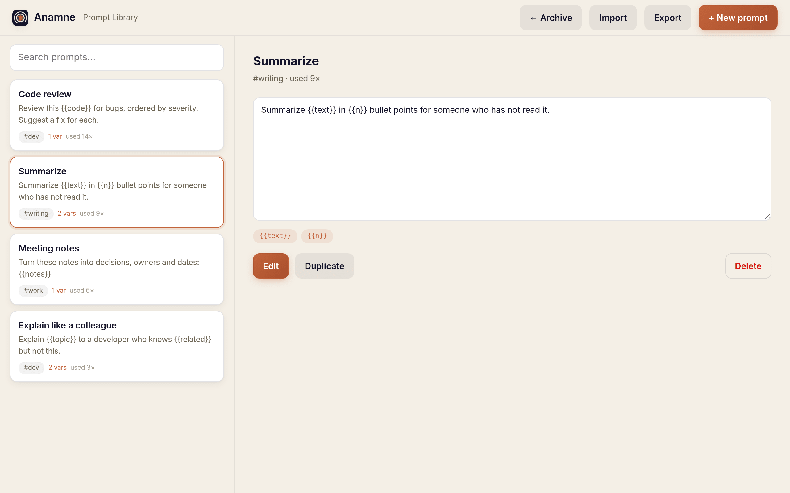
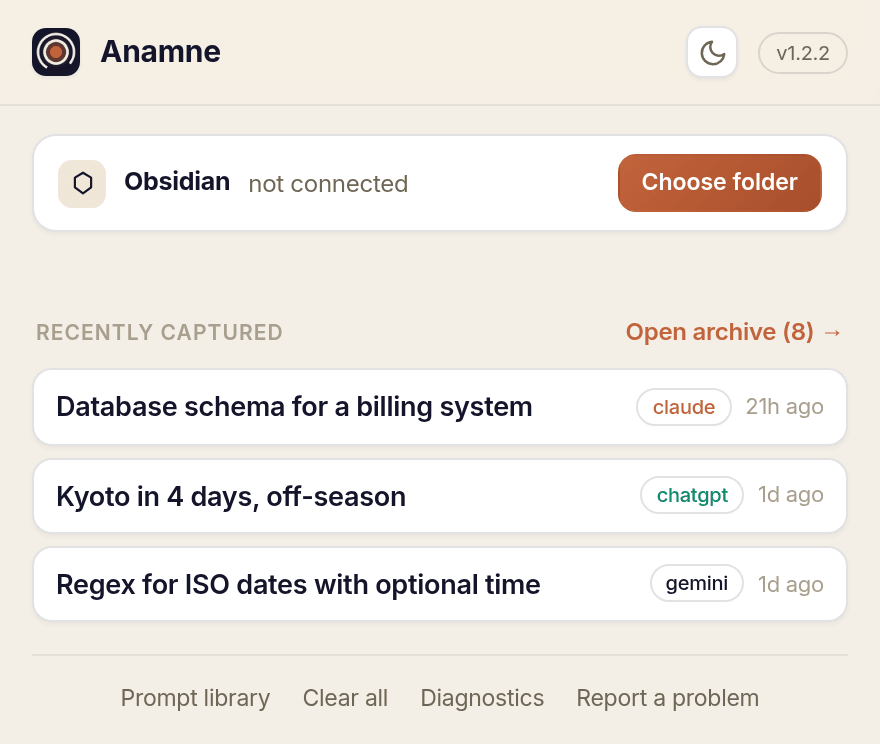
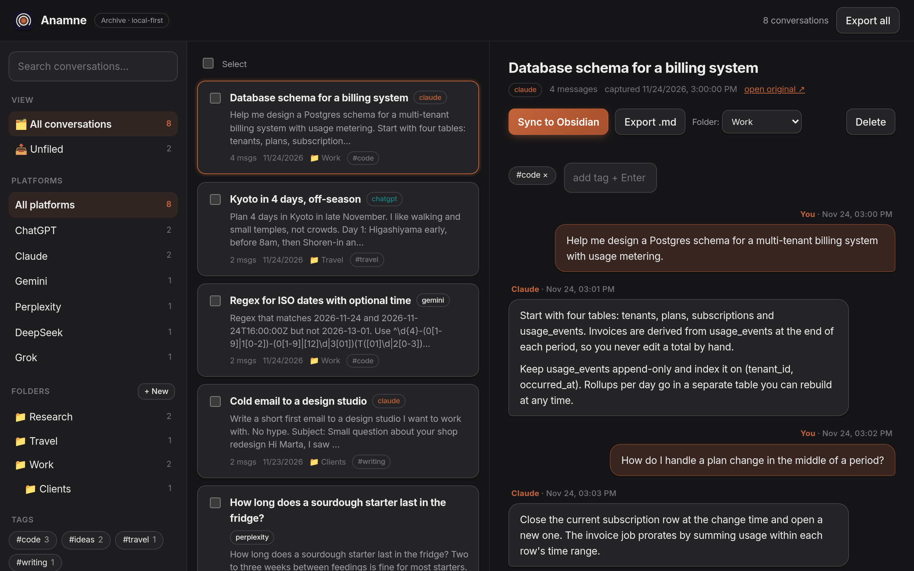

<p align="center"></p>

<h1 align="center">Anamne</h1>

<p align="center">A free, open-source Chrome extension that keeps every AI conversation you have in a private, searchable archive.<br>
ChatGPT, Claude, Gemini, Perplexity, Grok and DeepSeek in one place, synced to Obsidian as Markdown if you want.</p>

<p align="center"><a href="https://chromewebstore.google.com/detail/famgjpiggdaenmgnemmcjobbogdmghlj">Chrome Web Store</a> · <a href="https://getanamne.com">getanamne.com</a></p>



## Features

- **Automatic capture:** open or refresh a conversation on a supported site and it's saved. No buttons, no copy and paste.
- **One archive for every assistant:** filter by platform, file conversations into nested folders, add tags, select several and act on them at once.
- **Full-text search** across titles and every message, with matches highlighted.
- **Obsidian sync:** each conversation becomes a Markdown note with YAML frontmatter, written into a folder of your vault. Re-syncing updates notes that changed.
- **Images:** pictures generated in ChatGPT and Gemini, and the ones you uploaded, are stored with the conversation and written next to the note.
- **Export all:** every conversation as Markdown, with its images, in one `.zip`. Single conversations export as `.md`.
- **Prompt library:** save prompts with `{{variables}}` and insert them from a button on the chat sites; Anamne asks for the values first.
- **Report a problem** from the popup: pick the site and what's wrong, add a note if you like, and it reaches the developer. Nothing from your conversations is sent.
- **Light and dark theme.**

### Search



### Obsidian

Pick your vault folder once from the popup. Conversations land in `AI Conversations/<Platform>/`, one note each:

```markdown
---
title: "Database schema for a billing system"
platform: claude
created: 2026-11-24
captured: 2026-11-24
source_url: https://claude.ai/chat/8f3a21c4-5b6d-4e7f-9a0b-1c2d3e4f5a6b
message_count: 2
tags: [ai, ai/claude, code]
---

## 🧑 You · 2026-11-24 15:00

Help me design a Postgres schema for a multi-tenant billing system with usage metering.

## 🤖 Claude · 2026-11-24 15:01

Start with four tables: tenants, plans, subscriptions and usage_events. ...
```

The file is named `2026-11-24 Database schema for a billing system (8f3a21c4).md`. Images go to `AI Conversations/_attachments/<conversation>/` and are embedded in the note.

### Prompt library

| | |
|---|---|
|  |  |
| Prompts with `{{variables}}`, searchable, with a use count. Import and export as JSON. | The popup: Obsidian status, the latest captures and a link to the archive. |

<p></p>

## Install

### Option 1: Chrome Web Store

Install [Anamne from the Chrome Web Store](https://chromewebstore.google.com/detail/famgjpiggdaenmgnemmcjobbogdmghlj). It updates by itself.

### Option 2: Load from source

There is no build step; the files in this repository are the extension.

```sh
git clone https://github.com/mdrzn/getAnamne.git
```

1. Open `chrome://extensions` and turn on **Developer mode**.
2. Click **Load unpacked** and select the `getAnamne` folder.
3. Open a conversation on a supported site. It appears in the popup.

Built and tested on Chrome. Other Chromium browsers should work but are untested. Obsidian sync needs the File System Access API, which Firefox and Safari don't have.

## How capture works

Anamne reads the JSON the chat sites already download, not the rendered page, so a redesign of a site's layout doesn't break it.

1. `inject.js` runs in the page's own context and wraps `fetch` and `XMLHttpRequest`. It copies the response bodies of conversation endpoints and never changes the originals.
2. `platforms.js` decides which endpoints are conversations, one entry per site.
3. `bridge.js` forwards those payloads to the service worker.
4. `background.js` turns them into one common shape with `parsers.js` and stores them in IndexedDB through `db.js`.
5. `popup.js`, `archive.js` and `prompts.js` are the extension pages. `obsidian.js` writes to your vault from those pages, because the File System Access API needs a window and a click.

When a site changes its API, the popup's **Diagnostics** view lists every request Anamne saw and whether it matched. Attach that log to a bug report.

## Privacy

Anamne has no account and no analytics, and no server ever receives your conversations. They're stored in your browser's IndexedDB and leave it only when you sync or export them to a folder you chose.

The extension makes these network requests:

| What | Where | When |
|---|---|---|
| ChatGPT images | `chatgpt.com`, with your existing session | when a captured ChatGPT conversation has images |
| Gemini images | `lh3.googleusercontent.com` | when a captured Gemini conversation has images |
| Problem report | `getanamne.com/report.php`, forwarded to the developer on Telegram | only when you fill in **Report a problem** and click Send |

Everything else it reads is traffic the chat site's own page already made.

## Limitations

- A conversation is saved when you open or refresh it. Replies you're receiving right now are added the next time the conversation loads.
- The archive lives in one browser profile. Clearing site data for the extension or uninstalling it deletes the archive, so sync to Obsidian or use **Export all** if you want a copy.
- Each site's API is undocumented and changes without notice. When one changes, capture for that site stops until the parser is updated.

## Development

Tests are plain Node scripts (Node 18 or later, no dependencies):

```sh
for t in test/*.test.mjs; do node "$t" || exit 1; done
```

They cover the parsers (with recorded, anonymized payloads from each site), the endpoint rules, image extraction, the Markdown renderer, archive search, prompt templating and the zip writer.

`tools/package.sh` writes `dist/anamne-v<version>.zip` with only the runtime files, ready for the Chrome Web Store.

To add a site:

1. Add an entry to `PLATFORMS` and `HOST_PATTERNS` in `platforms.js`.
2. Add a `parse<Site>` function in `parsers.js` and register it in the `PARSERS` map in `background.js`.
3. Add the host to `host_permissions` and the three `content_scripts` match lists in `manifest.json`.
4. Add a test in `test/parsers.test.mjs` with a real payload, with personal content replaced.

## Contribute

Bug reports and pull requests are welcome. For capture bugs, include the site, what you expected to see and the Diagnostics log from the popup, with private details removed. Keep pull requests focused, and add or update a test when you change parsing.

## Credits

Made by [mdrzn](https://github.com/mdrzn). MIT License.

Anamne is an independent project with no affiliation to OpenAI, Anthropic, Google, Perplexity, xAI, DeepSeek or Obsidian.
